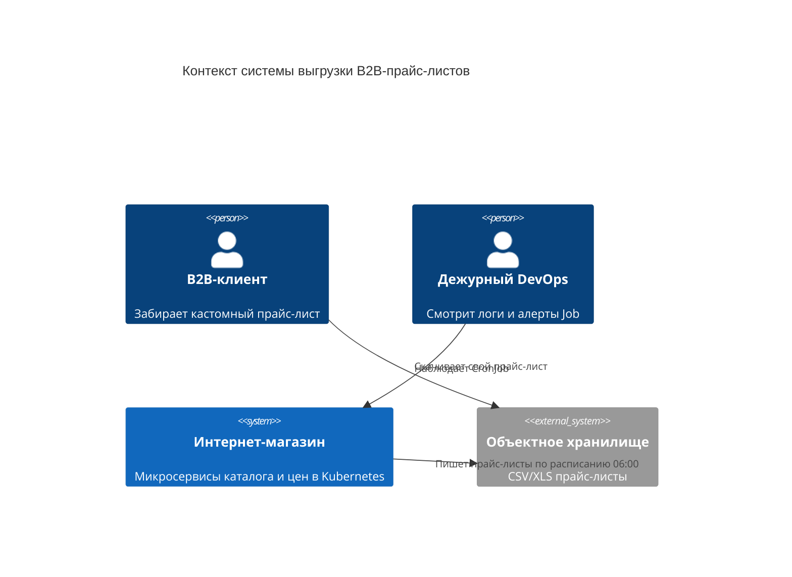
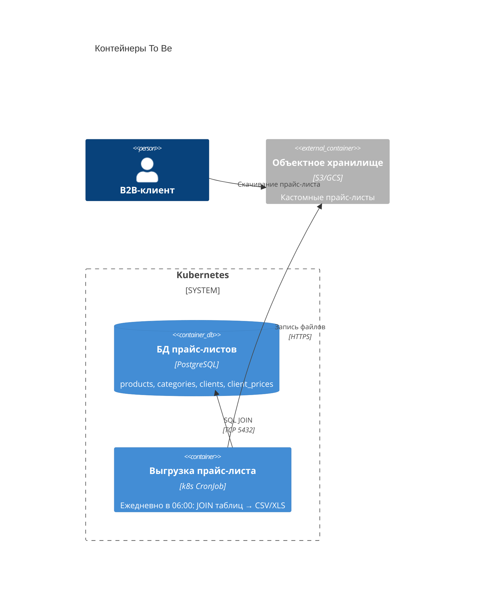

# Task 2. C4 To Be — выгрузка B2B-прайс-листов

Исходный `.drawio`: [c4-to-be.drawio](c4-to-be.drawio).

## System Context

## Container

Единственный новый контейнер внутри кластера — CronJob. Оркестратор Airflow и Spark-кластер не появляются.
