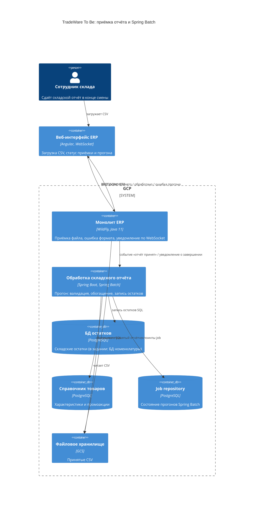

# Task 4. C4 To Be — Spring Batch

Исходный Draw.io: [c4-to-be.drawio](c4-to-be.drawio).

WildFly больше не пишет остатки построчно из HTTP. Прогон живёт в сервисе рядом — шаг к выносу из монолита.
